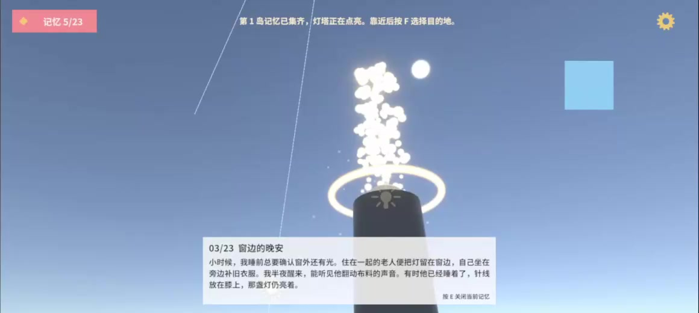

# 星屿

> 收集散落的记忆，点亮岛屿上的灯塔。

**Unity 3D · 第一人称探索 · 叙事收集 · 开发中**


*上图为项目使用的开始界面背景，关卡场景仍在制作中。*

## 项目介绍

《星屿》是一款基于 Unity 开发的第一人称 3D 叙事探索游戏，也是一个持续开发中的本科毕业设计项目。项目以低多边形美术、柔和光照和低压力探索为设计方向，将星尘收集、记忆文字与灯塔点亮结合起来，围绕陪伴、告别与重新出发展开叙事。

玩家在陌生的岛屿中醒来，通过寻找散落的星尘，逐渐拼合遗失的记忆。每座岛屿上的灯塔与本岛收集进度关联：集齐记忆后，灯塔点亮，通往下一座岛屿的旅程随之开启。

目前项目已搭建三岛核心玩法原型，正在完善关卡路线、美术表现、声音和结局。

## 演示视频

[](docs/media/xingyu-demo.mp4)

[查看演示视频](docs/media/xingyu-demo.mp4) · [下载 MP4](https://github.com/akachl/xingyu/raw/refs/heads/main/docs/media/xingyu-demo.mp4)

视频约 51 秒，展示开始菜单、设置、第一人称移动、星尘记忆收集、灯塔点亮及岛屿传送。公开视频裁去了编辑器外框，未保留原始录音和媒体附带信息；画面为开发中的玩法原型。

## 核心玩法

**探索岛屿 → 收集星尘 → 阅读记忆 → 点亮灯塔 → 解锁下一座岛屿**

- **探索与移动**：使用第一人称视角移动、跳跃，跌落后回到当前岛屿的安全点。
- **星尘与记忆**：23 颗星尘分别对应一段记忆，收集时更新进度并展示文字。
- **灯塔与传送**：集齐本岛星尘后自动点亮灯塔，靠近灯塔可选择目的地。
- **风场与滑翔**：借助风场上升；进入第三岛后解锁滑翔，在下降时延长空中移动时间。

项目以无战斗、低压力的探索体验为目标，让收集进度同时承担路线引导和叙事推进的作用。

## 三岛设计

| 岛屿 | 星尘数量 | 叙事主题 | 玩法侧重 |
| --- | --- | --- | --- |
| 晨雾花谷 | 5 | 陪伴与勇气 | 熟悉移动、跳跃和记忆收集 |
| 落霞枫林 | 8 | 回忆与告别 | 探索风场与高处收集点 |
| 星辉雪顶 | 10 | 接受与重新出发 | 解锁滑翔，继续寻找记忆 |

当前三个岛屿均位于 `game` 场景中，通过灯塔传送切换位置。岛屿主题是后续场景制作的方向，现有地形以基础平台和玩法验证布局为主。

## 当前实现

- **角色控制**：基于 `CharacterController` 实现移动、跳跃、重力、风场抬升与滑翔，使用鼠标控制第一人称视角。
- **收集系统**：按唯一编号记录星尘，防止重复计数，并分别统计三座岛屿的完成情况。
- **记忆展示**：使用 `ScriptableObject` 管理 23 段记忆数据，通过 TextMeshPro 显示标题与正文，支持文字面板宽度适配和淡入淡出。
- **灯塔反馈**：根据本岛收集状态触发点亮，配合灯光、粒子和扩散光环表现完成反馈。
- **岛屿解锁**：第一岛完成后开放第二岛，前两岛完成后开放第三岛；支持返回上一座岛屿，并更新跌落复位点。
- **界面交互**：包含开始菜单、暂停设置、返回标题和传送面板，通过统一的暂停状态协调角色输入、鼠标与界面显示。
- **音频控制**：使用 AudioMixer 分别控制音乐和音效音量，保存音量偏好，并接入星尘拾取与灯塔点亮音效。

收集进度只在本次游戏中保留，返回标题后重新开始会重置；音量偏好通过 `PlayerPrefs` 保存。

## 技术栈

| 项目 | 使用方案 |
| --- | --- |
| 引擎 | Unity 2022.3.62f2c1 |
| 渲染管线 | Universal Render Pipeline 14.0.12 |
| 编程语言 | C# |
| 目标平台 | Windows PC |
| 角色控制 | CharacterController |
| 输入 | Unity 旧版 Input Manager |
| 界面 | UGUI、TextMeshPro 3.0.7 |
| 记忆数据 | ScriptableObject |
| 音频 | AudioSource、AudioMixer |

## 开始运行

1. 将仓库克隆到本地，或下载 ZIP 后解压：

   ```bash
   git clone https://github.com/akachl/xingyu.git Xingyu
   ```

2. 在 Unity Hub 中添加克隆后的项目目录，建议使用工程记录的 **Unity 2022.3.62f2c1** 打开。
3. 等待 Unity 完成资源导入和依赖解析。
4. 打开 `Assets/Scenes/start.unity`，点击编辑器中的 **Play**，再通过“开始游戏”进入主场景。
5. 调试玩法时，也可直接打开 `Assets/Scenes/game.unity`。

构建列表已配置 `start`、`game` 两个场景。需要生成 Windows 版本时，在 **File → Build Settings** 中选择 Windows 平台，确认场景顺序后执行构建；若尚未安装对应模块，先通过 Unity Hub 添加 Windows Build Support。

当前以 Unity 工程形式提供，Windows 构建与完整通关验证仍在后续计划中。

## 操作说明

| 操作 | 按键 / 方式 |
| --- | --- |
| 移动 | `W` / `A` / `S` / `D` |
| 转动视角 | 鼠标移动 |
| 跳跃 | `Space` |
| 滑翔 | 解锁后，在空中下降时按住 `Space`；松开恢复下落 |
| 收集星尘 | 靠近并触碰星尘 |
| 关闭当前记忆文字 | `E` |
| 打开 / 关闭灯塔传送面板 | 靠近当前岛屿灯塔后按 `F` |
| 暂停 / 恢复 | `Esc` |
| 选择目的地、调整音量 | 鼠标操作界面 |

## 项目结构

```text
Assets/
├── Data/Stardust/          # 23 段星尘记忆数据
├── Editor/                # 场景搭建与灯塔效果配置工具
├── Images/                # 开始界面背景
├── Materials/             # 场景与交互物材质
├── Model/                 # 模型资源
├── Prefabs/               # 预制体
├── Resources/Audio/       # 混音器与交互音效
├── Scenes/
│   ├── start.unity        # 开始菜单
│   └── game.unity         # 三岛玩法主场景
├── Scripts/
│   ├── Player/            # 移动、视角与跌落复位
│   └── ...                # 收集、灯塔、传送、风场、界面与音频
├── Settings/              # 渲染配置
└── UI/                    # 界面资源
Packages/                  # Unity 包依赖
ProjectSettings/           # 工程设置
```

## 后续计划

- [ ] 完善三座岛屿的地形、探索路线与低多边形环境美术。
- [ ] 补充第三座灯塔完成后的结局与叙事收束。
- [ ] 完善背景音乐、环境声和脚步声，调整整体音量与交互听感。
- [ ] 完成从标题进入、三岛收集到结局的全流程试玩。
- [ ] 进行 Windows 构建、性能检查与分辨率适配验证。
- [x] 提供开发中玩法原型的演示视频。
- [ ] 补充正式场景截图和完整流程演示。

## 素材与使用说明

项目包含第三方模型、天空盒、字体及特效资源，相关素材的版权与使用范围以各自许可为准。

本仓库用于毕业设计开发记录与作品展示。目前未设置项目级开源许可证；代码与素材的使用、修改和再分发权限需分别确认。
